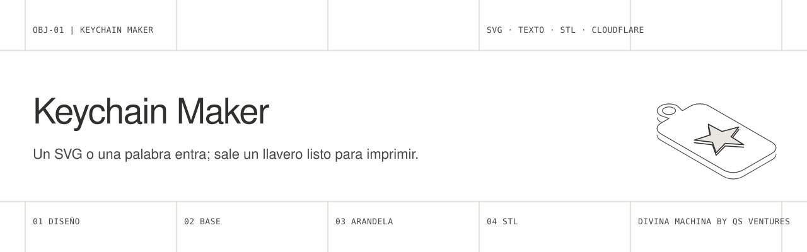
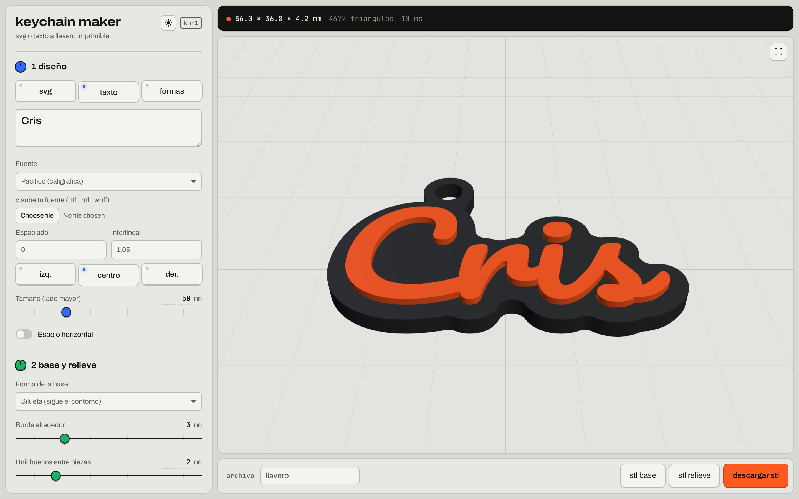
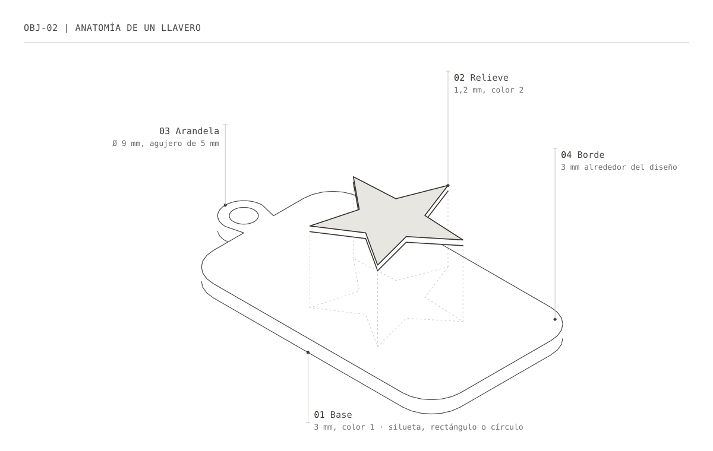
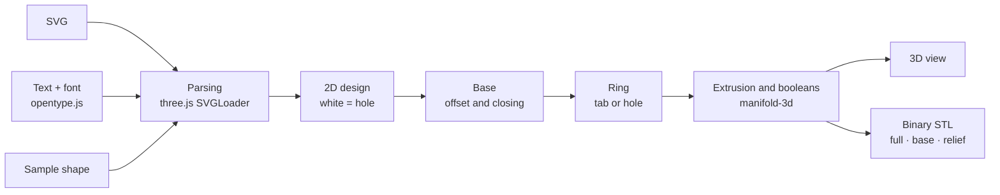
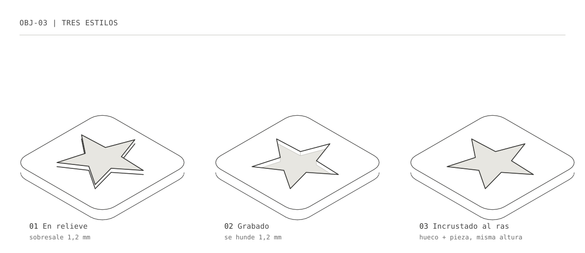

<picture>
  <source media="(prefers-color-scheme: dark)" srcset="docs/assets/banner-dark.svg">
  
</picture>

<p>
  <a href="README.md">Español</a> ·
  <a href="https://keychain-maker.olmedcr.workers.dev">Open the app</a> ·
  <a href="docs/01-uso.md">Usage</a> ·
  <a href="docs/02-geometria.md">Geometry</a> ·
  <a href="docs/03-impresion.md">Printing</a> ·
  <a href="docs/04-despliegue.md">Deploy</a>
</p>

A **3D-printable keychain** generator that runs in the browser. Give it an **SVG**, a **word** or a **shape**, choose the base, the relief and where the **ring** goes, and download the **STL**. Everything is computed on your machine: the design never leaves the browser.

It replaces a manual Fusion 360 routine: 2D sketch, insert SVG, extrude, draw the ring, join, export. Here it takes seconds, and the meshes always come out closed and ready for the slicer.

The interface is in Spanish; the guides in `docs/` are in Spanish too.

<p align="center">
  
</p>

## What it does

| | Step | Options |
|---|---|---|
| 01 | **Design** | SVG (drop, pick or paste), text with six bundled fonts or your own (.ttf, .otf, .woff), sample shapes. Size of the longest side in mm, mirror. |
| 02 | **Base and relief** | Silhouette base (follows the outline), rounded rectangle, circle or no base. Raised, engraved, or flush inlay for two colours. |
| 03 | **Ring** | Tab outside the base or hole inside it. Placed automatically by angle, or with a click in the 3D view. Diameters, offset and its own thickness. |
| 04 | **STL** | One STL with everything fused into a single solid, or base and relief separately for two-colour printing. |

<picture>
  <source media="(prefers-color-scheme: dark)" srcset="docs/assets/llavero-dark.svg">
  
</picture>

## How it works



Three ideas hold the design together:

1. **Always a closed mesh.** Booleans and extrusion run in [manifold-3d](https://github.com/elalish/manifold), which guarantees manifold solids. The slicer has nothing to repair.
2. **The SVG is read the way the browser paints it.** Layers stack in order; white areas of a logo become holes, and strokes become fills. A logo with a white background or counters comes out right without editing it.
3. **Nothing leaves the browser.** No server processes the design: the Cloudflare Worker only serves static files. The last design is kept in the user's `localStorage`.

## Getting started

Use it: **[keychain-maker.olmedcr.workers.dev](https://keychain-maker.olmedcr.workers.dev)**.

Locally, with Node 22 or later:

```bash
git clone https://github.com/olmedcr-cmyk/keychain-maker.git && cd keychain-maker
npm install
npm run dev        # http://localhost:5173
```

Deploy to your own Cloudflare account:

```bash
npx wrangler login   # once
npm run deploy       # build + wrangler deploy
```

## Three relief styles

<picture>
  <source media="(prefers-color-scheme: dark)" srcset="docs/assets/estilos-dark.svg">
  
</picture>

With **flush inlay** you get two STLs that fit together: the base with the pocket and the part that fills it. In a multi-material slicer (AMS, MMU), load them together as one object with two parts.

## Tested

- **12 tests** with [Vitest](https://vitest.dev) on every change (GitHub CI). One runs the five sample shapes through 4 bases, 3 styles and 3 ring types (180 keychains) and checks that the full part, the base and the relief are closed surfaces. Others cover two-line text, the requested size, the engraving depth limit and the binary STL layout.
- The closed-surface check has a test of its own: it catches a keychain missing one triangle.
- **Deployed and opened** on Cloudflare Workers, in light and dark, on desktop and mobile, with no console errors.
- **Not printed as part of these checks.** STLs are validated as closed meshes, not by printing them. If you print one and something is off, open an issue with the STL and your settings.

## Credits

Designed by **Divina Machina by Qs Ventures** (Cris Olmedo). Built on [three.js](https://threejs.org) (MIT), [manifold-3d](https://github.com/elalish/manifold) (Apache-2.0) and [opentype.js](https://opentype.js.org) (MIT). Fonts from [Fontsource](https://fontsource.org), OFL. Figures follow the [Hairline](https://github.com/lucasmarkes/hairline) grammar (MIT).

[MIT](LICENSE) licence.
