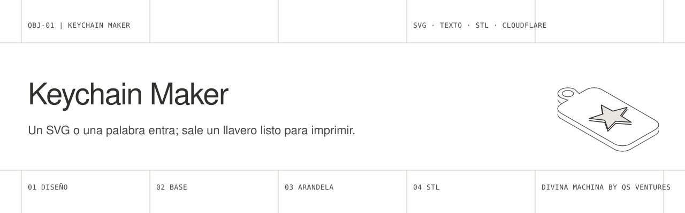
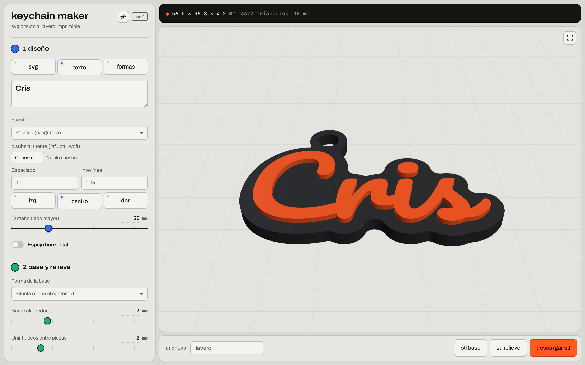
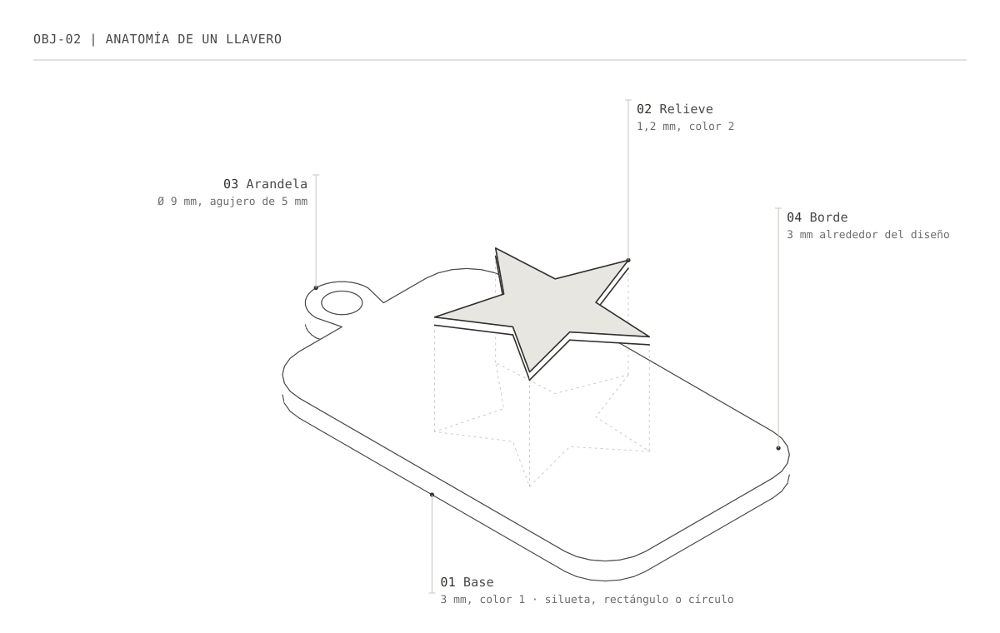
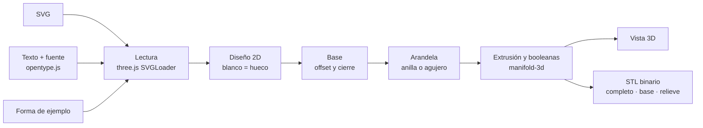
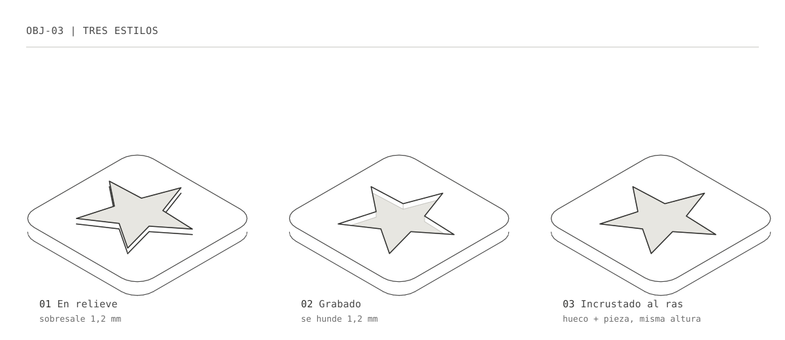

<picture>
  <source media="(prefers-color-scheme: dark)" srcset="docs/assets/banner-dark.svg">
  
</picture>

<p>
  <a href="README.en.md">English</a> ·
  <a href="https://keychain-maker.olmedcr.workers.dev">Abrir la app</a> ·
  <a href="docs/01-uso.md">Uso</a> ·
  <a href="docs/02-geometria.md">Geometría</a> ·
  <a href="docs/03-impresion.md">Impresión</a> ·
  <a href="docs/04-despliegue.md">Despliegue</a>
</p>

Un generador de **llaveros para impresión 3D** que funciona en el navegador. Le das un **SVG**, una **palabra** o una **forma**, eliges la base, el relieve y dónde va la **arandela**, y descargas el **STL**. Todo se calcula en tu máquina: el diseño no sale del navegador.

Sustituye un flujo que se hacía a mano en Fusion 360: boceto 2D, insertar el SVG, extruir, dibujar la arandela, unir y exportar. Aquí son unos segundos y salen siempre mallas cerradas, listas para el laminador.

<p align="center">
  
</p>

## Qué hace

| | Paso | Opciones |
|---|---|---|
| 01 | **Diseño** | SVG (arrastrar, elegir o pegar), texto con seis fuentes incluidas o la tuya (.ttf, .otf, .woff), formas de ejemplo. Tamaño del lado mayor en mm y espejo. |
| 02 | **Base y relieve** | Base en silueta (sigue el contorno), rectángulo redondeado, círculo o sin base. Relieve que sobresale, grabado o incrustado al ras para dos colores. |
| 03 | **Arandela** | Anilla exterior o agujero dentro de la base. Colocación automática por ángulo o con un clic en la vista 3D. Diámetros, desplazamiento y grosor propio. |
| 04 | **STL** | Un STL con todo fundido en un sólido, o base y relieve por separado para imprimir en dos colores. |

<picture>
  <source media="(prefers-color-scheme: dark)" srcset="docs/assets/llavero-dark.svg">
  
</picture>

## Cómo funciona



Tres ideas sostienen el diseño:

1. **Siempre una malla cerrada.** Las booleanas y la extrusión las hace [manifold-3d](https://github.com/elalish/manifold), que garantiza sólidos *manifold*. El laminador no tiene que reparar nada.
2. **El SVG se lee como lo pinta el navegador.** Las capas se apilan en orden; las zonas blancas de un logo se tratan como huecos, y los trazos se convierten en relleno. Así un logo con fondo blanco o contraformas sale bien sin tocarlo.
3. **Nada sale del navegador.** No hay servidor que procese el diseño: el Worker de Cloudflare solo sirve archivos estáticos. El último diseño se guarda en el `localStorage` de quien lo usa.

## Empezar

Usarlo: **[keychain-maker.olmedcr.workers.dev](https://keychain-maker.olmedcr.workers.dev)**.

En local, con Node 22 o posterior:

```bash
git clone https://github.com/olmedcr-cmyk/keychain-maker.git && cd keychain-maker
npm install
npm run dev        # http://localhost:5173
```

Publicarlo en tu propia cuenta de Cloudflare:

```bash
npx wrangler login   # una vez
npm run deploy       # build + wrangler deploy
```

Más detalle en la [guía de despliegue](docs/04-despliegue.md).

## Tres estilos de relieve

<picture>
  <source media="(prefers-color-scheme: dark)" srcset="docs/assets/estilos-dark.svg">
  
</picture>

Con **incrustado al ras** se descargan dos STL que encajan: la base con el hueco y la pieza que lo llena. En un laminador con varios colores (AMS, MMU) se cargan juntos como un objeto de dos partes. Consejos de impresión en la [guía de impresión](docs/03-impresion.md).

## Probado

- **12 tests** con [Vitest](https://vitest.dev) en cada cambio (CI de GitHub). Uno recorre las cinco formas de ejemplo con las 4 bases, los 3 estilos y los 3 tipos de arandela (180 llaveros) y comprueba que la pieza completa, la base y el relieve son superficies cerradas. Otros cubren texto en dos líneas, el tamaño pedido, el límite de profundidad del grabado y el formato binario del STL.
- La comprobación de superficie cerrada tiene su propio test: si a un llavero le falta un triángulo, lo detecta.
- **Desplegado y abierto** en Cloudflare Workers, en claro y en oscuro, en escritorio y en móvil, sin errores en la consola.
- **Sin probar en impresora como parte de estas pruebas.** Los STL se validan como mallas cerradas, no imprimiéndolos. Si imprimes uno y algo no encaja, abre un issue con el STL y los ajustes.

## Estructura

```
keychain-maker/
├── index.html              # la interfaz
├── src/
│   ├── keychain.ts         # motor geométrico: diseño → base → arandela → sólidos
│   ├── svg.ts              # SVG → polígonos (capas, blancos, trazos)
│   ├── text.ts             # texto → SVG con fuentes reales
│   ├── shapes.ts           # formas de ejemplo
│   ├── viewer.ts           # vista 3D (three.js)
│   ├── stl.ts              # STL binario
│   ├── main.ts             # interfaz, estado y exportación
│   └── style.css           # tema claro y oscuro
├── test/                   # Vitest
├── docs/                   # guías y figuras (docs/assets/src genera las figuras)
├── wrangler.jsonc          # Worker de Cloudflare que sirve dist/
└── vite.config.ts
```

## Créditos

Diseñado por **Divina Machina by Qs Ventures** (Cris Olmedo). Construido sobre [three.js](https://threejs.org) (MIT), [manifold-3d](https://github.com/elalish/manifold) (Apache-2.0) y [opentype.js](https://opentype.js.org) (MIT). Las fuentes vienen de [Fontsource](https://fontsource.org) con licencia OFL. Las figuras siguen la gramática de [Hairline](https://github.com/lucasmarkes/hairline) (MIT).

Antes de empezar se revisaron [lombad/svg-to-stl](https://github.com/lombad/svg-to-stl), [bekuto3d](https://github.com/littlesound/bekuto3d) y [vecto3d](https://github.com/gauravsonii/vecto3d): resuelven la extrusión, pero no la base, la arandela ni los dos colores.

Licencia [MIT](LICENSE).
